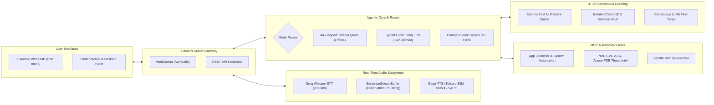

# 🌟 Project Chloe 2.0

> **Agentic, Ultra-Low Latency Personal AI Assistant Built Exclusively for Abhishek**

[](https://www.python.org/)
[](https://fastapi.tiangolo.com/)
[](https://flutter.dev/)
[](https://ollama.com/)
[](https://github.com/thewh1teagle/kokoro-onnx)
[](LICENSE)

Project Chloe combines bidirectional real-time neural voice conversation, autonomous Model Context Protocol (MCP) tool execution (cybersecurity intelligence, system control, stealth deep web scraping), and split-path RAG document intelligence with full cross-platform compatibility across Windows Desktop and Android.

---

## 🏛️ Architecture Overview



---

## 🧩 Core Capabilities

### 1. ⚡ Ultra-Low Latency Audio Pipeline
- **STT**: Groq Whisper API (`whisper-large-v3-turbo`) transcribing in ~200–400ms.
- **Punctuation Streaming**: `SentenceStreamBuffer` chunks LLM tokens at natural clauses (`.`, `?`, `!`, `\n`) for immediate sentence-by-sentence synthesis without waiting for full response completion.
- **4-Tier TTS Waterfall**:
  1. *Microsoft Edge-TTS* (Online High-Fidelity Neural Stream: `en-US-AriaNeural`)
  2. *Kokoro-82M ONNX* (100% Offline Local Neural Voice)
  3. *Ollama Kokoro TTS Endpoint*
  4. *Windows SAPI5 / pyttsx3* (Zero-Dependency Offline Hardware Failsafe)

### 2. 🛡️ 3 Operating Modes
- 🛡️ **Air-Gapped Local (`FULLY_ISOLATED`)**: 100% offline via local Ollama models (`qwen2.5:1.5b`, `chloe:latest`), 0 external internet traffic, local tool actions.
- ⚡ **Fast Hybrid Local (`PARTIALLY_ISOLATED`)**: Sub-second cloud inference via Groq LPUs (`qwen3.8-27b`) with full local MCP execution.
- 🧠 **Frontier Cloud (`COMPLETELY_OPEN`)**: Google Gemini 3.6 Flash for multi-turn 1M+ token reasoning, coding, and multimodal intelligence.

### 3. 🧠 3-Tier Continuous Learning & Memory
- **Tier 1 (Sub-ms FastPath)**: Direct pattern matching & local intent resolution executing in <0.5ms.
- **Tier 2 (ChromaDB Vector Vault)**: Isolated continuous learning collection persistently capturing habits, preferences, and recurring workflows.
- **Tier 3 (LoRA Training Pipeline)**: Local dataset generator & LoRA exporter (`backend/scripts/train_lora.py`) compiling personal datasets into custom Ollama models (`chloe:latest`).

### 4. 🛠️ Autonomous MCP Tools
- **System Tools**: App launcher (Chrome, VS Code, Spotify, Discord, Terminal, Task Manager), Notepad notes, File search & creation, Sandbox command execution, Hardware telemetry.
- **Cyber Intelligence**: NIST NVD CVE 2.0 vulnerability lookup, AbuseIPDB threat reputation check, Asynchronous multi-threaded TCP port scanner.
- **Web Intelligence**: Stealth DuckDuckGo crawler with concurrent article content extraction and summarization.

### 5. 💻 Dual Interfaces
- **Web HUD (`backend/app/static/`)**: Cyberpunk dark glassmorphic dashboard with live 24fps animated Chloe avatar, Web Audio API waveform visualizers, mic capture, and QR pairing for Android phones over LAN/Tailscale.
- **Flutter Client (`frontend_flutter/`)**: Cross-platform Android & Windows client with glassmorphism, animated waveform HUD, and audio queue player.

---

## 🚀 Getting Started

### Prerequisites
- Python 3.10+ (Python 3.11 or 3.13 recommended)
- Git
- Optional: [Ollama](https://ollama.com/) (for 100% air-gapped local AI mode)

### 1. Clone the Repository
```bash
git clone https://github.com/<your-username>/Chloe.git
cd Chloe
```

### 2. Configure Environment
Copy the configuration template and add your optional API keys:
```bash
cp .env.example .env
```

### 3. Install Dependencies
```bash
pip install -r requirements.txt
```

### 4. Download Offline Neural Voice Models (Kokoro-82M)
Run the automated downloader to fetch the offline Kokoro TTS ONNX model and voice weights:
```bash
python tools/download_models.py
```

### 5. Launch Project Chloe

**One-Click Launch on Windows:**
```powershell
.\start.ps1
```
*Or directly via Python:*
```bash
python run.py
```

Once started, access the Web HUD in your browser:
👉 **`http://localhost:8000`**

To stop all services cleanly:
```powershell
.\stop.ps1
```

---

## 🧙 Windows Setup Wizard & Standalone Installer

Project Chloe features an interactive Windows Setup Wizard and standalone compilation pipeline:
- **Interactive Wizard (`installer/setup_wizard.py`)**: Dark-themed installer that configures directories, shortcut deployment (Desktop, Start Menu, Startup), API keys, and automatically downloads and installs Ollama & local models silently.
- **Compile Standalone Executable**:
  ```bash
  python installer/build_all_in_one.py
  ```

---

## 📁 Repository Structure

```
Chloe/
├── backend/
│   ├── app/
│   │   ├── audio/          # STT, SentenceStreamBuffer, 4-tier TTS Waterfall
│   │   ├── core/           # LangGraph router, NLP fast-path, Memory engine, Orchestrator
│   │   ├── db/             # Storage & persistence abstraction
│   │   ├── mcp/            # System tools, Cyber threat intel, Web search
│   │   ├── pipeline/       # Split-path RAG ingestion & offloading
│   │   ├── static/         # Cyberpunk Web HUD (HTML5, CSS3, ES6, Avatar frames)
│   │   ├── config.py       # Centralized settings & environment loader
│   │   └── main.py         # FastAPI application & WebSocket audio gateway
│   ├── models/             # Neural models directory (Kokoro ONNX, Ollama Modelfile)
│   ├── scripts/            # LoRA fine-tuning & Ollama persona export scripts
│   └── requirements.txt    # Python dependencies
├── frontend_flutter/       # Cross-platform Flutter client for Android & Desktop
├── installer/              # Windows Setup Wizard & all-in-one packaging pipeline
├── tests/                  # End-to-end integration & unit test suite
├── tools/                  # Model downloaders & utility scripts
├── .env.example            # Environment configuration template
├── .gitignore              # Production gitignore (excluding weights, caches, secrets)
├── run.py                  # Core server launcher & verification
├── start.ps1               # One-click Windows activation script
├── stop.ps1                # One-click Windows shutdown script
└── requirements.txt        # Root requirements mirror
```

---

## 🔒 Security & Privacy Notice

- **No Hardcoded Secrets**: Project Chloe strictly manages all credentials through `.env`.
- **Air-Gapped Mode**: When running in `FULLY_ISOLATED` mode, 0 external network requests are dispatched; all reasoning and voice synthesis occur locally on device.
- **Isolated Continuous Learning**: Memory databases are stored locally in your chosen storage directory (`data/`) and never uploaded to public clouds.

---

## 📜 License

Distributed under the MIT License. See `LICENSE` for details.
